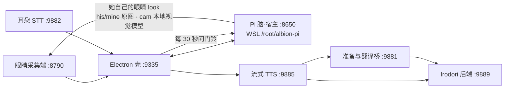

# 项目脉络与生产入口

2026-10-02 整理。唯一总仓：`mydosu/albion-companion`（公开，2026-10-25 起；此前的历史留在私有仓库 `mydosu/Albion-Companion-Wife`），本机根 `D:\AI\Wife`。
整理前生产工作区已保存并推送为 `f59d4bbaa6de35426e9a459ac22cafa461f8f78d`。
这次只调整文件分类、路径引用、重建材料和文档，没有升级业务或部署新版本。
**2026-10-14 更新**：脑已从 WSL Hermes 换成 Pi 版（WSL `/root/albion-pi/`，宿主仍是 :8650，
但只做协议转接 + 醒来门铃）；她多了自己的眼睛（`look`）和自己定醒来时间（`next_wake`）。
下游链路（壳、耳朵、TTS、翻译桥）没有变。

| 职责 | 当前源码/入口 | 迭代时看哪里 |
|---|---|---|
| 构建版总启动 | 根 `一键启动-构建版.bat` → `start_all.bat` | 根启动器及 `pet/check_all.py` |
| 开发/原入口 | 根 `一键启动-dev.bat`、`一键启动.bat` → `start_all.bat dev` | dev 入口后台启动；原入口保留各服务控制台；所有入口共用服务启动实现 |
| 桌面壳、聊天、主动存在、展示与播放 | `shell/apps/stage-tamagotchi/`、`shell/packages/stage-ui/`、`shell/packages/core-agent/`、音频 packages | 对应目录 `AGENTS.md`、package README 与 Vitest |
| 耳朵 | `pet/start_ear.bat` → `pet/whisper_serve.py` | `tests/pet/check_ear.py`，模型在本地 `pet/models/` |
| 眼睛 | `pet/tools/eyes/capture_agent.py`、启动脚本 | `pet/tools/eyes/README.md`；脑里 `look` 打的就是它的 :8790 |
| 状态摆件 | `pet/widget/albion_status_widget.pyw` | 本地位置状态不入库 |
| 语音后端 | `tts/irodori/start_backend.bat` → `irodori_serve.py`，以及 `serve_v2.py`、规划/情感/渲染模块 | `ships.json`，`tests/tts/` |
| 准备/翻译桥 | `tts/irodori/start_bridge.bat` → `bridge.py` + `bridge_v2.py` | 默认 `codex` 历史分支：Command Code 主路，Codex CLI 最终退路；`api` 需独立 key |
| 流式切句与会话 | `tts/stream/start_stream.bat` → `stream_server.py` + `session_text.py` | `tests/tts/test_credit_patience.py` 与壳音频 tests |
| 备用 Denia | `tts/GPT-sovits/启动Denia后端.bat` | 备用链路，不作为当前 Irodori 主线 |
| 脑（阿尔比恩本人） | WSL `/root/albion-pi/`（`start.sh`／`accept.sh`，宿主 :8650） | 仓库镜像 `integrations/pi-brain/`（与现网逐文件一致）；见其 README |
| 她自己的眼睛 | 脑里 `look` 工具 → 主力机/本机采集端 :8790 | 主力机上单独部署一份；仓库来源见 `pet/tools/eyes/` |

脑不再是 Hermes 网关，也没有单独的语音插件：她的话由壳从自己的 store 取正文再送 TTS（端点契约没变）。
WSL 旧脑（Hermes `albion` profile）已于 2026-10-07 删除，归档在 `/root/albion-pi/archive/hermes-profile-20261007/`。
不要凭文件名中的 v2/v3 判断是否废弃：`bridge_v2.py`、`serve_v2.py` 是主线依赖。
生产源码是否使用应沿入口/import 查证；旧副本归档依据是 `.bak`、明确 rollback 目录及一次性补丁用途。

`docs/` 原设计与上线记录保留，它们是历史解释；已确认失效并归档的迁入 `docs/history/`。当前文件分类以 `FILE_LAYOUT.md` 为准；
当前部署事实以源码、`config/rebuild/runtime.json` 与实际环境为准。README 上游版本介绍不代表本机基础权重版本。
改耳朵/端口/模型目录前先看 [`ASR路径清单.md`](ASR路径清单.md)：它列了「改一处要连带改哪几处」；
侧车打包与本地语音服务的启动细节见 [`打包与语音服务.md`](打包与语音服务.md)。

WSL 的 `.env`、SOUL、会话数据库、skills、作品和 Windows Hermes 私人配置独立于 Git。SOUL.md（她的人格）只在 WSL 生产里改，不进仓库。
Windows 主 Hermes 与 Albion skills 必须保持隔离，重建时不可导入 Windows 通用技能树。
