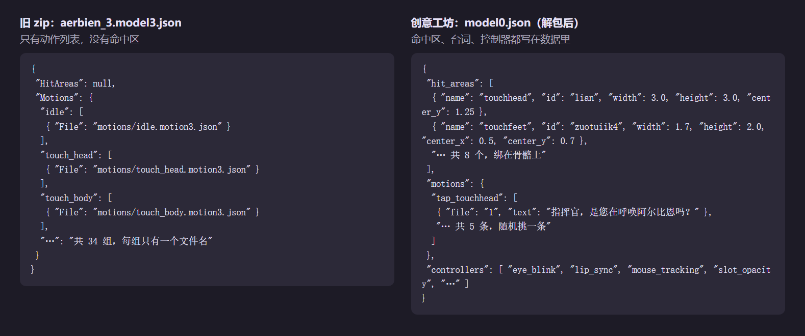

# 01 找到喜欢角色的模型，判断能不能用

目标：拿到一份你喜欢的角色的 Live2D 或 Spine 模型，而且在动手改壳之前就知道它能不能用、哪些功能做得出来。

我不会画画，也请不起画师，所以只能用现成的模型。下面是我找阿尔比恩模型时走过的路。

## 去哪里找

我先后用过三份阿尔比恩的模型，来源不同，质量差很多：

| 来源 | 是什么 | 优点 | 缺点 |
|---|---|---|---|
| GitHub 上玩家整理的游戏解包仓库（我用的是 `MilkyLan/AzurLane-Live2d`，Live2D 和 `spinepainting/` 下的 Spine 都有） | 游戏原样导出的模型文件 | 格式规整，和游戏里一样 | 只有模型和动作，**没有交互定义**：哪里能点、点了播什么都得自己猜 |
| 自己打包的旧 zip | 别人转过一手的 Live2D | 拿来就能用 | 触摸网格和画面对不上（摸头的区域落在裙摆上），怎么调都调不准 |
| Live2DViewerEX 创意工坊的作品（`.wpk`） | 模型作者在原模型上做好了交互 | **交互全写在数据里**：命中区、拖动、菜单、台词、动作链 | 文件是加密的，要解包 |

最后我用的是创意工坊那份。有作者写好的交互数据，后面能省掉大半的猜测。

差在哪，把两份包的描述文件拆开并排看一眼就明白（左边是旧 zip 的 Live2D，右边是我现在用的创意工坊 Spine 包「晨光里的事故」）。GitHub 解包那份和游戏原样一致，只有模型和动作，跟左边差不多，就不放了：

左边 `HitAreas` 是空的，34 组动作每组只有一个文件名。哪里能点、点了播哪组、播完接什么，全得自己猜。右边每个命中区绑在一根骨骼上，点了播哪组、组里有哪几句台词都写好了，还带眨眼、口型、鼠标跟随这些控制器的参数。

### 创意工坊的包长什么样

- `.wpk` 和里面的 `.lpk` 都是 zip，但 lpk 里的文件是加密的（`config.mlve` 里写着 `encrypt: "true"`，条目名是一串 md5）。社区有现成的解包工具（我用的是 LpkUnpacker），我没有自己写解密。
- 解出来最重要的是 `model0.json`（Spine 的是 `modelN.json`）：它是**作者写的完整交互规格**，包括命中区、每组动作循不循环、播完接哪个、优先级、台词和语音、拖动哪个参数。

> 加密是作者对作品的保护。解包只给自己本地用，**别把解出来的文件再发出去**，能联系上作者的话最好先问一句。

## 拿到之后先检查这几项

### 1. 格式和版本对不对得上

- **Live2D**：AIRI 走的是 Cubism 4 那套，也就是 `.moc3` + `model3.json`。
- **Spine**：`.skel` 是二进制文件，版本必须和运行时一致。碧蓝航线的素材是 **Spine 3.8** 时代导出的，AIRI 自带的 4.x 运行时读不了。我专门给壳加了一条 3.8 的渲染链路，见第 02 篇。

### 2. 模型里到底有什么

想复刻游戏里的某个彩蛋，先去模型数据里查**有没有对应的部件和参数**，再决定做不做。

我当时想做的几个手游彩蛋，查 `cdi3.json`（201 个部件、759 个参数）的结果是这样的：

| 想要的 | 模型里有吗 | 结论 |
|---|---|---|
| 点天空放孔明灯 | 旧包里没有孔明灯，只有蝴蝶 | 改成「点天空，蝴蝶飞」，或者换包 |
| 点小黄鸡，它会洒水 | 没有鸡也没有水 | 要自己画，纯写代码做不出来 |
| 拍照模式 | 照片组、快门、黑框、提示闪光都有 | 做得到 |

后来换成创意工坊的包，孔明灯、小鸡菜单、相机模式都有了，因为作者做进去了。

> 经验：**素材不在模型里，写多少代码都变不出来。** 先查数据，再许诺功能。

### 3. 有没有交互数据

打开 `model3.json` 看 `Motions`（动作组）和 `HitAreas`（命中区）。有作者的 `model0.json` 就更好，后面的交互全部照它来做（第 02 篇会讲为什么一定要照作者的来）。

动作组名字可以先猜个大概，写一张对照表。我当时那份 34 组的表里，标了哪些是推断的：

| 动作组 | 大概是什么 |
|---|---|
| `idle`、`idle1`…`idle5` | 空闲的几个变体 |
| `touch_head` / `touch_body` / `touch_special` | 摸头 / 摸身体 / 特殊部位 |
| `touch_drag1`…`4` | 拖动反应（推断） |
| `login` / `home` / `mission_complete` / `wedding` | 登录、回港、任务完成、誓约这类事件 |

想确认某一组长什么样，就在壳里直接播它看（我留了一个调试口 `__albionPet.play('组名')`）。

### 4. 画布是什么形状

阿尔比恩的模型是**一整幅场景**：人、背景、道具画在同一张 8000×8000 的画布上（换包后是 966×966）。这会带来两个问题：

- 取景：AIRI 默认只露上半身，要改（第 02 篇）。
- 窗口比例：美术是竖的，桌宠窗口是横的，下半身的互动点就会落在窗口外面。

拿到模型先想好窗口是横还是竖。

### 5. 加载不出来时，先拿官方样例对照

AIRI 自带样例模型（hiyori）。用它走同一条加载路径：样例能出来、你的出不来，就是包本身有问题；样例也出不来，就是加载器坏了。这一步能省很多时间。

## 版权

角色的立绘、模型和配音版权属于原作方，创意工坊作品的交互数据属于模型作者。我的仓库里**不放任何模型、动作文件和语音**，只放让壳能读这些数据的代码。

你自己做的时候也一样：模型放在本机、不进仓库（我的壳里 `**/assets/live2d/models/*` 是被 gitignore 的），发截图和视频时注明出处。
