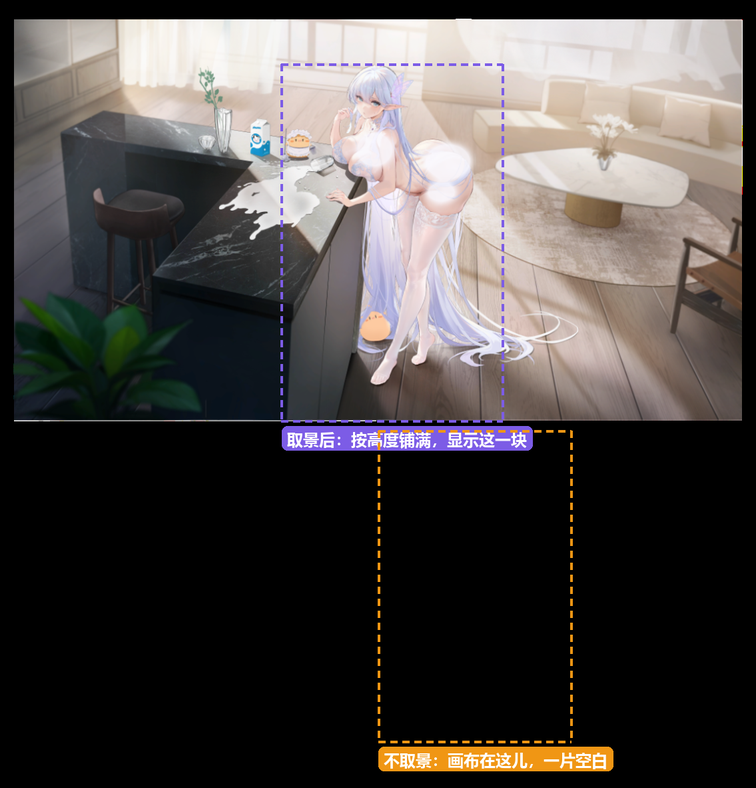
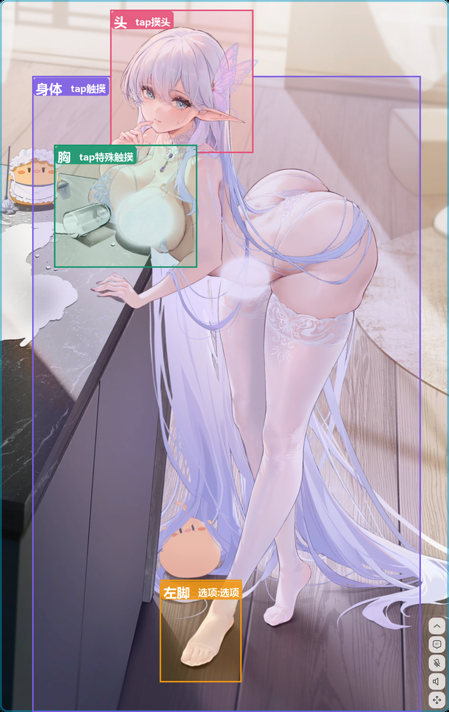

# 02 AIRI 壳不适配找到的模型，怎么改

目标：让第 01 篇找到的模型在 AIRI 桌宠（`stage-tamagotchi`，Electron 版）里正常显示，动作衔接顺，点哪里就有哪里的反应。

这一篇是我花时间最多的地方，前后改了三十多轮。先说结论，再分 Live2D 和 Spine 两部分讲坑。

## 最大的教训：完全按作者原文件来

我前后做了很多「自以为更好」的改动：给动作加淡入淡出、把两层空闲动画离线合成一条、自己找循环点、在接缝处做交叉混合……每一版测出来数据都更好，但看起来总是不对劲。

最后查出根因：**我的转换脚本把 34 个动作文件全部重新序列化过一遍，体积只剩作者原件的 45%~55%**，是有损的。再叠上我自造的那些规则，所以怎么调都对不上。

后来全部推倒：动作文件**逐字节搬作者原件**，壳里只执行作者数据里写了的字段（循环标记、动作链、分层、优先级），作者没写的就不做。这样一改，反而最顺。

> 你的模型如果带作者的交互数据，**先原样跑起来，再考虑改**。改之前先确认不对的是不是作者本来的设计。我追了很久的「闪一下」，最后查出来是作者故意让一批小星点硬切开关，属于设计。

## Live2D 部分

### 1. 加载不出来

| 现象 | 真正的原因 | 怎么办 |
|---|---|---|
| 报 `Unknown settings format`，看着像格式不支持 | zip 里的路径分隔符是反斜杠（`aerbien_3\aerbien_3.moc3`）。Windows 上的一些打包工具会这样写，而加载器用正斜杠去匹配，结果一个文件都没匹配上 | 用 Python 的 `zipfile` 重新写一遍，条目名统一用 `/` |
| 修好了还是报同样的错 | 第一次失败的空响应被缓存进了浏览器的 OPFS，之后一直读这份坏档 | 清掉 `navigator.storage.getDirectory()` 下对应的目录 |
| 浏览器里报 `Empty zip file`，Electron 里正常 | IDM 之类的下载工具会劫持浏览器里的二进制响应，变成 204 空包 | 退出它的浏览器集成，或者直接用 Electron 版测 |
| 对象一路透传，到解析时报错 | AIRI 传的是 `{ url, id }`，靠一层解包中间件转成 zip，这层在新版 pixi 下已经注册不上了 | 我直接改成传 URL 字符串，走 pixi 原生的加载分支 |

### 2. 默认设置改了不生效

这是 AIRI 最容易让人怀疑人生的地方，我踩了好几次：

- **别往 localStorage 里塞值**：各个 store 启动时会用自己的默认值写回去，你塞的会被盖掉。正确做法是改 fork 里 store 的默认值。
- **角色卡会覆盖你的设置**：`localStorage['airi-cards']` 里的角色卡带着一份 `speech / hearing / vision / consciousness` 模块的快照，每次启动都会写回 store。改完设置要把它也写回卡里。
- **别的窗口会用旧值盖回来**：开着的设置窗、聊天窗（URL 带 `synced-leader=false`）会拿自己那份旧状态覆盖共享的 localStorage。设置改了不生效，先看看是不是还开着别的窗口。
- **写完别马上强杀进程**：localStorage 底下是 LevelDB，还没落盘就被杀，写入就丢了，看起来像「被程序改回去了」。

### 3. 取景：只露上半身

AIRI 原本的设计是模型原点贴着窗口底边、再放大 2 倍，所以只露上半身。我的模型又是整幅场景，怎么拖都只有半身。

- 把桌宠端的适配倍数从 2 改成 1（`fit-model.ts` 的 `fitMultiplier`，网页版不动）。
- 缩放和位置最后用界面滑块手动调，调好的值写进 store 默认值。

几个反直觉的地方：

- **模型一直在动**。空闲动画里头发会往上飘，按某一帧量好的取景，到别的帧可能被上边界切掉。我后来改成采样 12 秒、48 帧，按极值来定。
- **窗口比例决定能看到多少**。横窗口配竖美术，下半身必然被裁，和取景怎么调无关。
- 我后来在托盘里加了「把当前布局存为推荐」：自己摆好，点一下存下来。主进程往渲染进程的 localStorage 写值后，要**手动派发一次 `StorageEvent`**，同一个窗口里写入不会自动触发 vueuse 的监听。

### 4. 动作不顺

按我遇到的先后顺序：

1. **空闲动作根本没播**：pixi-live2d-display 把空闲组名写死成大写的 `"Idle"`，我的模型里只有小写的 `idle`。模型里得真有一个 `Idle` 组。
2. **切换都是硬切**：淡入淡出时间要写在**每个 motion3 文件自己的 `Meta.FadeInTime / FadeOutTime`** 里。写在 `model3.json` 里的那个字段只对表情生效，我在这里白忙了一轮。
3. **标了循环也不循环**：`pixi-live2d-display@0.4.0` 全文件只定义了 `setIsLoop()`，**从来没调用过**，所以 motion3 里写 `Loop: true` 没用。要在壳里自己调 `motion.setIsLoop(true)` 和 `setIsLoopFadeIn(true)`。
   - pixi 是**按需创建**动作对象的，第一次播的瞬间就把时长定了，那时候再设循环已经晚了。所以开机时把每个要循环的动作预热一帧。
   - 预热要用更高的优先级，同优先级会被 pixi 直接拒绝，动作对象就建不出来。
4. **作者的动作是分层同时播的**：Live2DViewerEX 的组名写成 `名字#层号`，不同层同时播，高层覆盖同名参数。我那份包里，`Idle` 是身体，`Idle#1` 是特效层（风、花瓣、星点），**特效层里一条四肢曲线都没有**，单独播它人就像冻住了。pixi 一次只能播一个动作，所以我让 pixi 播第 0 层，第 1 层及以上在每帧里调 SDK 的 `CubismMotion.doUpdateParameters()` 自己推进。
5. **动作链**：作者用 `NextMtn` 写了「触摸动作播完接哪个姿势循环」，照着接就行，不用自己编。
6. **打断规则**：作者给每个动作标了 `Priority` 和 `Interruptable`。引擎源码里没有仲裁逻辑（在闭源 App 里），我按字段语义自己实现：新动作优先级不低于当前的就放行，更低的只有当前这条可打断才放行。
   - 优先级到时间要降回来，**别用 `setTimeout`**：Electron 窗口在后台时，定时器会被节流到分钟级。改成记时间戳，下次判定时看过没过期。

关于「循环接缝跳一下」：我试过线性漂移、Hermite 修正、末端收敛、找自相似点……最后全部撤掉，回到作者原文件加 SDK 自带的循环淡入。那一下跳是作者文件自己的循环点，接受它，或者只在数据层做最小改动。**别在渲染层每帧追着改**，下面会说为什么。

### 5. 命中区和交互

**命中判定要用模型坐标系**：用模型自己的 `hitTest()` 或 `toModelPosition()`，窗口挪动、缩放都不受影响。按窗口比例切「上 1/3 是头」这种做法我一开始用过，很快就不行了。

**作者的命中网格不一定和画面对齐**。我的包里命中网格整体比看得见的美术大一截、还偏右下。所以我按命中网格测一切正常，点画面却没反应。修法：

- 取两个参考点（头、小黄鸡），解出「命中区 → 画面」的仿射变换（每个轴一个缩放加一个平移）。
- 点击判定反着解（画面 → 命中区），画框提示正着解。**这两个方向我写反过一次，结果全画布都点不到。**
- 一个仿射对不齐所有区域，因为作者的网格是一块块手摆的。用户明确圈过的区域，就单独登记它在画面上的实际范围。
- 参考点要**同一帧、客观量出来**：模型一直在动，拿旧截图量就会越解越偏。也别让视觉模型估位置，同一张图问三次能给出三个值，只能用来定性核对（「这块是不是脸」）。
- 再加一个现场微调：我用的是 Alt + 方向键整体挪区域，Alt + S 存下来。准不准最后靠眼睛定。

**拖动交互**（作者的 `ParamHit`）：

- 同一块区域可能既能点又能拖。按下先记一下，指针动了 6px 以上才算拖动，否则松手算点击。不这样做，点头会被当成拖头饰。
- 同一块区域上的几条参数要**一起拖**。我的包里一个摇杆同时驱动「视角」和「手柄」两组 X/Y，一开始只挂了一条，只能动一个方向。
- `ReleaseType` 是缓动曲线，不是「松手回不回弹」；回不回弹看 `LockParam`。
- 要锁住的参数（`LockParam: true`），在 pixi 更新之后的一个阶段**每帧写回**，否则空闲动作会把它写回去。

> 每帧写回的参数，混合时要基于**引擎这一帧算出的原始值**，不能基于你上一帧写过的值。我做过一个运行时旋钮，在自己写过的值上反复混合，几帧之内参数就塌到起点，人物冻住了。拿不到原始值，就改数据层。

**让看不见的区域看得见**：命中区本来是隐形的，还跟着模型动。我加了鼠标悬停高亮（显示这块是什么、怎么操作），按 H 键或鼠标中键画出全部区域。还有一个保命键：右键或 Esc 把所有互动参数复位，免得卡在相机模式里出不来。

### 6. 换模型时别让交互层错乱

交互数据是模型专属的（区域名、参数名都是作者给这个模型起的）。我在初始化时抽查几个标志参数，当前模型一个都没有，就判定「不是这个模型」，整个交互层不启用。

## Spine 部分（3.8）

碧蓝航线的 Spine 素材是 3.8 导出的，AIRI 自带的是 4.x 运行时，读不了。我**另开了一条独立的渲染链路**（`pixi-spine` + `@pixi-spine/runtime-3.8`），不碰 4.x 那边的任何代码，两套 API 差异太大，共用会互相牵制。

下面每一条都在代码注释里留了记录，都是画面出问题以后逐个查出来的：

| 现象 | 原因 | 怎么办 |
|---|---|---|
| 画布全白，报 `reading 'start'` | 壳用的是模块化 Pixi（`@pixi/*`），渲染插件要显式注册 | 在 `new Application` 之前注册 `TickerPlugin` 和 `BatchRenderer` |
| `Region not found in atlas`，第二页的图全丢 | pixi-spine 的 atlas 解析器只认**空行**当页面分隔，导出的 atlas 第二页前面没空行 | 读 atlas 时在每个新页面头前补一个空行。别在属性块后也补，会把第一个区域当成新页面 |
| 解析停在第一页 | atlas 加载器是回调式的，下一页在回调里才解析 | 回调一定要调，而且传 `BaseTexture`，不是 `Texture` |
| 半透明的地方发黑（脸红变成黑红） | 素材是预乘 alpha 导出的，但页名没带 `-pma` 后缀，被当成直通解释 | 显式标成预乘 |
| 部分网格位置错了（最多偏 213px） | pixi-spine 在 `yDown=true` 时，某个变换分支丢了行列式符号，46 根骨骼算错 | 关掉 `yDown`，上下翻转交给外层容器。和官方 spine-ts 逐帧逐顶点对比，误差为 0 |
| 包围盒、命中测试全是 0 | pixi 把加载期的 `region.updateOffset()` 注释掉了 | 加载后自己补调一次（只填几何，不改渲染） |
| 换装后画布空了 | 同一进程里建第二个 WebGL 上下文失败 | `Application` 只建一次，换装扮时复用 |
| 开发版正常，打包版看不到模型 | 打包后页面是 `file://`，Chromium 拒绝 `fetch(file://)` | 取不到时退回构建期资产 URL |
| 高分屏上发虚 | 模块化 Pixi 默认 1:1 像素比 | 给 2 倍缓冲 |
| 嘴一直张着 | 音量直接乘增益，66% 的帧贴在最大值 | 先加噪声门把底噪压成 0，再线性映射；而且只在播语音时驱动，平时交给待机动画 |

Spine 版作者的交互数据格式和 Live2D 版不一样，但思路相同：**直接执行作者的字段**。比如作者用变量（`var_floats`，「条件 equal N」「赋值 assign N」）实现了「同一组台词不连着重复」和「待机按表情切动画」，照着实现就行。表情是换整张脸图，和 Live2D 的姿态参数是两回事。

**取景**：Spine 版的模型原生有 4524×2487（连房间背景一起），而画布只有 1195×1925。不做处理直接画，画布里是一片空白：模型坐标是 y 朝上的，整张画都落在画布上方。我的做法是第一次显示时按高度铺满（缩放 = 画布高 ÷ 模型高，再把中心对齐），横向允许超出；用户手动拖过、缩放过之后，就不再自动覆盖。

下图是把模型缩小到能整张看见，再用壳里同一套视图换算，把两种情况下画布能看到的范围框出来（黑色是画布的透明区，云雾是我后加的）：

**动作衔接：同一段动画铺在两层上，要共用播放头**。作者的待机是把同一段 `normal` 同时放在脸层（0 轨）和身体层（1 轨）。我一开始换表情时只重启 0 轨，两层就错开了，而两层都会去写同一个槽（她手里拈着的那缕发梢 `faM-9`），各按各的时间轴挂图、清空。结果是发梢在手里突然没了，过一两秒又冒出来。修法：换表情时以「本来就在放的那层」的播放头为准，把另一层对齐过去。

[看对比（10 秒，MP4，0.5 倍慢放）](assets/02-layer-sync.mp4)：在运行中的壳里把两层播放头拨开 3 秒（左）和对齐（右），录同一段动画时间。左边手里的发梢在 13.37 秒消失，15.24 秒才回来。这两个时刻是逐帧记录槽上挂的图得到的，不是看出来的。

下面是 Spine 版作者的 4 个命中框，按壳里点击判定的同一套换算（骨骼世界坐标 × 模型高度 ÷ 17，再乘渲染倍率）画回画面上。截图是现在桌面上的实际状态。能看出来「胸」那一框明显偏左，压到了台面上的杯子。和 Live2D 版一样，**作者的命中区不保证和美术对齐**，画出来看一眼最省事：

## 排查方法（比具体的坑更有用）

- **给自己留调试出口**：我把模型挂到 `globalThis.__albionModel`，用 Chrome DevTools 协议（CDP）连上壳（启动时带 `--remote-debugging-port`），直接读骨架、参数、动作列表。比看日志可靠得多。
- **判断壳活没活着，要看页面能不能执行 `1+1`**，别靠 curl 端口：Vite 绑的是 IPv6 的 `localhost`，curl `127.0.0.1` 永远不通。用 CDP 时先 `Runtime.enable`，少了它会一直误判「页面没响应」。
- **`Page.reload` 可能把页面弄死**。改完代码要生效就重启壳。
- **Vite 返回 200 只说明没有语法错误**。引用了不存在的函数照样 200，要看运行时的 console。我有一次用字符串切片改源码，锚点没对上，删掉了 100 多行，页面照样「能编译」。
- **把「看起来不顺」变成数字**：录一段带时间戳的画面，算相邻帧的像素差；或者每帧遍历全部参数，记录这一帧最大的单参数突变。尖峰出现的间隔正好等于某个动作的时长，就知道是哪个动作的接缝。
- **别往用户正在用的设置里写测试值**：我验证托盘推送时往实时设置写了个测试值，模型当场跳了一下。用「同值回放」或单独的调试口。
