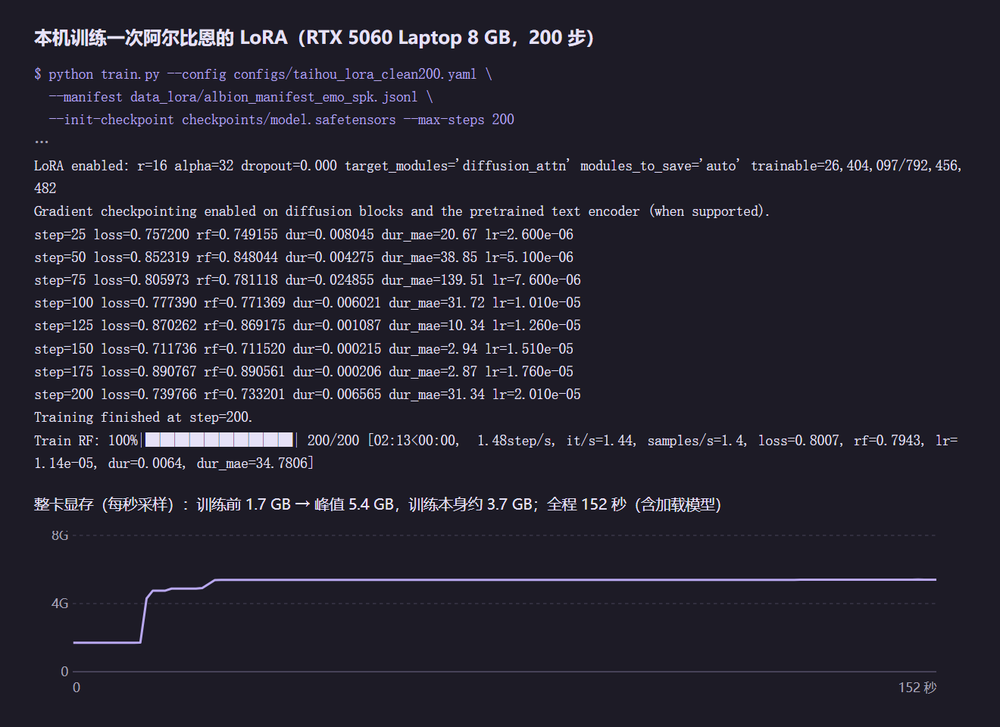

# 03 训练角色声音

目标：她说话用的是角色本人的声音，而且你跟她说中文，她也能用这个声音回答。

我用的是 [Irodori-TTS](https://github.com/Aratako/Irodori-TTS)（日语 TTS，底模 [Irodori-TTS-v4.1-Small](https://huggingface.co/Aratako/Irodori-TTS-v4.1-Small)）做 LoRA 微调。思路对别的 TTS 也通用。

## 整体分四段

```
① 数据   官方语音 + 官方原文 → 清洗、配对 → 训练清单
② 训练   清单 → 微调（LoRA 或说话人嵌入）→ 权重
③ 推理   常驻后端加载底模 + 挂她的 LoRA
④ 使用   她生成的中文 → 翻译成角色原声的语言 → 合成 → 播放
```

## 先说为什么用 Irodori：我是从 GPT-SoVITS 换过来的

我一开始用的是 GPT-SoVITS（GSV），完整训过一轮五个角色，两天后全部换成了 Irodori。原因：

| | GSV（我当时的做法） | Irodori |
|---|---|---|
| 数据 | 长于 24 秒的要切开，逐条配文，再用语音识别抽查刀口 | 每条音频还是要配上它念的文本，但直接用官方原文整理成清单，**不用打标**（不用语音识别转写、不用逐条修正） |
| 训练 | 租云端 4090 48G：SoVITS 100 轮约 37 分钟，再训 GPT；存了 9×2 档权重，挨个试听 18 种组合选一个 | 本机 8 GB 显卡挂 LoRA 跑几百步就行，**音色已经很接近原声** |
| 推理 | 每句都要一段参考音频，情绪靠挑参考音（还得先给参考音按情绪分类） | 可以不给参考音频，用一句日语风格描述控制语气 |
| 情感 | 受参考音限制，参考音里没有的语气就出不来 | 情感表现力强得多，亲密、气声这类语气也能直接生成（包括 NSFW 向的） |

> 如果你还在纠结用哪个：数据少、不想打标、想要情感表现力，先试 Irodori。它只会说日语，所以中文要先翻译（见下面的 ④）。

## ① 数据：音频和官方原文一一对应

阿尔比恩只有日配，没有中文配音，所以语料是**官方日语语音 + 官方日文台词**。

1. **音频**：从碧蓝航线 biligame wiki 的台词页扒。页面上每句台词是「文本 + mp3 地址」紧挨着的裸文本，按 `</a>` 切块，取出每块后面的音频地址，批量下载。
2. **文本**：用日文 wiki（`azurlane.wikiru.jp`）上的**官方日文原文**，按台词条目和音频对上。日文原文缺的那条就不要，别猜。
3. **整理成清单**：把音频和原文整理成 HuggingFace `datasets` 能读的本地数据（一列音频、一列文本），交给上游的 `prepare_manifest.py`（`--dataset`、`--audio-column`、`--text-column`、`--output-manifest`、`--latent-dir`）。它会把音频编码成训练用的 latent，输出每行一条 `{"text", "latent_path", "num_frames"}` 的清单。

就这三步。**不用跑语音识别、不用手动打标**，文本本来就是官方原文。

我的 Irodori 数据是直接复用 GSV 时整理好的那批：阿尔比恩 83 条（GSV 要求单条不超过 24 秒，所以里面有 16 条是长台词切开的）。Irodori 本身需不需要切，我没单独试过。

清单里还可以给每条加一句日语的风格描述（`caption`，比如「落ち着いた、静かな声で」）和说话人 id（`speaker_id`），训出来以后推理时就能用描述控制语气。我给阿尔比恩用了 7 种描述。

后来发现这 7 种固定描述的实测差别很小：只有最明亮那档能听出变快，更多是音色纹理变了；推理时也被锁死在这 7 句里，说别的没用。所以后来重标注了一遍，见下面的「重标注：让描述真的能控制语气」。

> 铁律：文本和音频必须一一对应，而且都是官方原文。不要拿中文翻译倒推日文，也不要用语音识别的结果当文本。

## ② 训练

两条路线：

- **LoRA**：音色主要靠它。
- **说话人嵌入（speaker inversion）**：只训一个很小的说话人向量，推理时代替参考音频。

我每个角色两样都训了，推理时一起挂上。两条路线都用同一个 `train.py`（LoRA 加 `--lora`，嵌入加 `--speaker-inversion`），不是另一个脚本。

上游自带两份配置可以照抄：`configs/train_v4_small_lora.yaml` 和 `configs/train_v4_small_speaker_inversion.yaml`。模型结构那一段别动，只改 `train:` 下面这些。我用的值：

| 参数 | 我的值 | 说明 |
|---|---|---|
| `manifest_path` / `output_dir` | 每个角色一份 | 用 `prepare_manifest.py` 生成的清单 |
| `lora_enabled` | `true` | |
| `lora_r` / `lora_alpha` | `16` / `32` | |
| `lora_target_modules` | `diffusion_attn` | 只挂在扩散部分的注意力层 |
| `max_steps` | 阿尔比恩现在是重标注后训到 1000 步、取第 500 步的检查点；数据重新清洗过的两个角色 `200` | 数据只有几十条，**步数不要多**，见下面的坑 |
| `save_every` | `100` | 留几个检查点，听完再挑 |
| `batch_size` | `1` | 配合 `gradient_checkpointing: true` 省显存 |
| `precision` | `bf16` | |
| `learning_rate` | `0.0001` | |

一次 LoRA 训练在本机就能跑。我在笔记本的 RTX 5060（8 GB）上实测了一次，200 步：



- 训练循环 2 分 13 秒，每秒约 1.5 步；算上加载模型一共两分半。阿尔比恩那份 500 步，大概 6 分钟。
- 训练本身占 3.7 GB 显存，整卡峰值 5.4 GB。**TTS 后端常驻时会占 4 GB 左右，两个加起来超过 8 GB，所以训练前要先把 TTS 后端关掉**，练完再开。
- 只挂 LoRA 的话，可训练参数是 2640 万，占全模型的 3.3%。

和 GSV 那边要租 48G 云卡比，门槛低很多。

（这次为了量时间和显存，用的是另一个角色的 yaml，只换了数据清单。那份配置的预热是 1000 步，所以图里的学习率还没爬上去，loss 也看不出趋势；真训练时按上面表里的参数来。）

### 踩过的坑：声音沙哑

大凤这种比较尖锐的声音用「LoRA + 说话人嵌入」叠在一起训练，出来的声音是哑的。最后的解决办法：

- 数据重新清洗一遍，只留干净的片段（那个角色最后用了 53 段）；
- 用干净数据重训说话人嵌入，LoRA 取第 200 步左右的检查点，不要训练太久；
- 推理时保留联合引导（cfg 4.5）。去掉以后整篇声音发糙。

结论：**声音哑、发糙，先怀疑数据不干净和训练过头，再去调参数。**

### 重标注：让描述真的能控制语气

先做了个实验：给模型喂训练集以外的自由描述。15 条里 8 条时长有可测的变化，6 条能把音高推高 13–17 Hz；而原来那 7 句，一条都推不动音高。

规律很清楚：**只有底模认识的「声音动作词」才有用**。早口、囁く、息、震えて、低い声、優しく这类，说得出效果；恥ずかしそう、甘えた、得意げ这种抽象情绪词，模型没反应。另外我把引导强度 cfg 从 2 调到 3、4、6，时长完全一样，音高也不单调——**cfg 不是强度旋钮**，别指望调它来加情绪。

那就重标注。我没把原声传给外部 API（游戏原声有版权，也费钱），全部在本地量：每条的语速、音高均值和起伏、能量、气声和停顿、句末上扬，加上原文，按这些数写一句 10–30 字的日语描述，只用声音动作词（没人逐条听过，好坏靠后面的评测）。每条同时保留原来那句固定描述当第二条样本，83 条变成 166 行「双 caption」——这样旧的推理方式在新 LoRA 上不会退化。

量的时候还发现，15 条旧情绪标签和实测韵律是反的（标「低い声」的实测反而偏高）。所以这次不抄旧标签，只信量出来的数。

重训 1000 步，每 250 步存一次。这里踩了个坑：我照抄的配置 warmup 正好也是 1000 步，学习率到最后才爬满，最终那份反而退化，**实际用的是第 500 步的检查点**。训练整卡峰值 6.3 GB，比之前那次高，**必须先停 TTS 后端**，单次 5.5 分钟。

结果：低沉、平淡的句子，新 LoRA 明显更像她，旧的音色偏粗；害羞、撒娇开始有时长反应，但音高还是推不动；快哭的句子反而是旧的更像。

后来又重训了一版（warmup 改成 100，留了约 10 条固定验证集），三条上线门槛有两条没过，没换。

评测也有坑。一开始我全拿同一句台词配不同描述来比，**台词内容和情绪不搭，听不出东西**。后来改做按场景配台词的评测集：8 种情绪 × 3 句内容匹配的台词 × 2 个 seed。

> 结论：描述只用声音动作词；双 caption 保住旧路径；评测台词要和情绪对得上；最后像不像，还是耳朵定。

## ③ 推理：做成常驻服务

- 后端常驻，一个进程里加载底模，每个角色的 LoRA 按需挂上。几个角色共用一份底模，省显存。
- 用一张表写「哪个角色用哪个 LoRA」，改表就能换权重，不用重启。权重目录名一定要写对，写错了不会报错，只是不生效。
- 后端加载要十几秒，其他服务要等它起来再连，否则开机后头几句没声音。

### 踩过的坑：越用越慢，然后开始丢句

用了一段时间后，一句话要合成四五十秒，超过超时就整句丢掉。原因是每合成一句都临时申请显存、用完不还，越积越多，8 GB 显卡被占满，Windows 把多出来的部分挪到内存里，速度慢了二三十倍。

解决：每合成完一句，就把用不着的显存还给系统。之后一句短句从四五十秒降到 2 秒多，显存稳定在 3 GB 左右。

> 如果你的 TTS 用久了变慢，先看显存是不是一直在涨。

## ④ 使用：让她说中文也用原声

模型只会说日语，而她平时用中文回复。所以中间加一个「桥」：

1. 收到要念的文字后，判断是不是中文；
2. 是中文就先调一个大模型翻译成日语，再交给 TTS；
3. 对外提供 OpenAI 兼容的语音接口（`/v1/audio/speech`），再补一个 `GET /v1/models` 列出音色（壳要用它校验和填下拉框）。这样 AIRI 壳和其他客户端填个地址就能用。
4. 括号里的心声（`（…）`、`【…】`、`*…*`）和 `<|…|>` 标记**只显示、不朗读**，在桥里剥掉。

翻译用的大模型记得**关掉思考**：DeepSeek 带思维链时一句要 1.7 秒（它先用英文想半天），关掉后 0.67 秒，译文一字不差。现在翻译跟着脑用同一个模型（我换成了 Gemini），换模型时同样要把思考压到最低。

### 接到 AIRI 壳上的坑

| 现象 | 原因 | 怎么办 |
|---|---|---|
| 壳里报 `Failed to fetch`，curl 却一切正常 | 桥没加 CORS，浏览器把响应丢了 | 桥里加 CORS 中间件（本机服务全都要加，耳朵也一样） |
| 她回文字但没声音，桥日志是 404 | AIRI 对 OpenAI 兼容的 TTS **只认 provider 配置里的 `model` 和 `voice`**，不看语音设置页；没填就发 `tts-1` / `alloy`，桥里没这个音色 | 把 `model`、`voice` 写进 provider 配置（我是改 fork 里的默认值） |
| 当前提供方是 `speech-noop` | 被设成了静音的空实现 | 改回 OpenAI 兼容那一项 |

桥里加一行 `[req] voice=… model=… len=…` 日志，以后「她没声音」先看这一行，一眼就知道是不是音色、模型传错了。

### 踩过的坑

| 现象 | 真正的原因 | 怎么办 |
|---|---|---|
| 出来是静音 | 中文没经过翻译就直接送去合成，日语模型念不出来 | 看桥的日志里收到的原文，确认翻译那一步跑了 |
| 说到一半不说了 | 翻译返回空，那一句被丢掉了 | 翻译失败要写日志；检查译文句数和长度是否对得上原文，不对就逐句重译 |
| 突然整段没声音 | 翻译用的 API Key 额度用完了 | 额度用完的 Key 先冷却一段时间，自动换下一把，别每句都白试一遍 |
| 把网址、代码念成一串怪话 | 模型把网址也「翻译」了，还会自己编台词 | 翻译前剥掉网址和路径；剩下没有能念的字，就只显示字幕、不出声 |
| 短句抢着说 | 默认切句器按词切，一百毫秒内连发好几句 | 先改成整句合成；想做到边想边说，见第 04 篇 |

## 怎么验收

- 从壳里真实地说一句，看桥的日志有没有收到；
- 导出几段 WAV 自己听：有没有声、是不是她、语气对不对；
- 机器能测的只有「有声音」，像不像她只能靠耳朵听。

## 效果

[听一下对比（17 秒，MP4）](assets/03-voice-compare.mp4)：前半段是游戏原声，后半段是训练后合成的一句新台词，这句不在训练数据里。两段我把响度拉到同一水平，只比音色。合成那句 8.6 秒的音频，本机生成用了 4.2 秒。

GitHub 上点开是下载或新标签播放，不能在页面里直接放。
